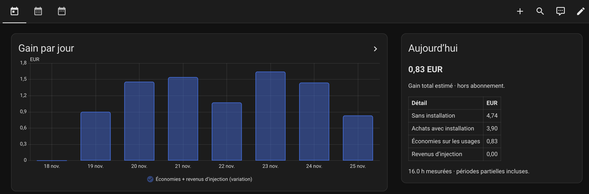

# Izypower Savings


**Pour estimer vos économies, il faut savoir ce que vos appareils consomment et ce que vous achetez au réseau au même instant.** Multiplier la production totale affichée dans l’app Izypower par votre tarif d’achat revient à supposer que chaque kWh produit a remplacé un achat au même prix.

Par exemple, vos panneaux produisent 3 kWh en une heure. Vos appareils en utilisent 1 et vous injectez gratuitement les 2 autres sur le réseau. Vous avez donc évité d’acheter **1 kWh**. Si cette heure est facturée à 0,25 €/kWh, vous économisez **0,25 €**. Avec la même production et la même consommation pendant une heure creuse à 0,15 €/kWh, vous économisez **0,15 €**.

Dans Home Assistant, vous choisissez deux capteurs de puissance (en W ou en kW). L’un mesure la consommation de vos appareils, l’autre les échanges avec le réseau. Izypower Savings utilise leurs **relevés horodatés** pour estimer les kWh consommés et achetés entre deux mesures et appliquer le tarif en vigueur sur chaque plage horaire. Si vous revendez le surplus, les revenus de la vente s’ajoutent aux économies. Le graphique affiche le gain par jour, par mois ou par année.

[**Izypower Cloud**](https://github.com/StefanPlizga/izypower_cloud) est une source possible pour ces mesures. Si une autre intégration fournit déjà ces puissances dans Home Assistant, vous pouvez aussi sélectionner ses capteurs. Izypower Savings lit les entités que vous choisissez. Aucun accès à Linky ou à votre espace client d’électricité n’est nécessaire.

**Première version publique expérimentale.** Les résultats sont des estimations fondées sur des relevés espacés. Ils servent à suivre un gain dans le temps, pas à reproduire une facture au centime près.



## Fonctionnalités

- Tarif unique, ou heures pleines / heures creuses.
- Heures super creuses facultatives, avec leur propre prix.
- Plusieurs plages quotidiennes, y compris des plages qui traversent minuit.
- Sans injection prévue, injection gratuite ou injection rémunérée.
- Choix des entités dans l’interface, avec des textes d’aide et des noms indicatifs.
- Consommations supplémentaires facultatives : une borne de recharge n’est pas nécessaire.
- Conservation des relevés **et des changements de tarifs** dans des fichiers locaux.
- Reprise des calculs après redémarrage, sans changer les anciens prix.
- Aucune commande envoyée à l’onduleur, à la batterie ou au compteur.

## Calcul des gains

Combien auriez-vous payé pour les **mêmes usages, aux mêmes heures**, sans panneaux ni batterie ? Pour répondre, l’intégration estime les kWh entre deux relevés de puissance par interpolation. Elle découpe le calcul à minuit et à chaque changement de tarif.

| Montant | Calcul pour chaque intervalle |
| --- | --- |
| Coût sans installation | kWh consommés par vos appareils × tarif d’achat |
| Achats avec installation | kWh prélevés sur le réseau × tarif d’achat |
| Économies sur les usages | Coût sans installation − achats avec installation |
| Revenus d’injection | kWh injectés × tarif de rachat en cas de revente, sinon 0 |
| **Gain affiché sur le graphique** | **Économies sur les usages + revenus d’injection** |

Chaque barre additionne les gains des intervalles mesurés sur le jour, le mois ou l’année. Les montants portent sur l’énergie, hors abonnement, achat et amortissement du matériel et autres frais contractuels.

### Exemple avec ou sans revente du surplus

Sur une heure, vos panneaux produisent **3 kWh**. Vos appareils en consomment **1 kWh** et les **2 kWh** restants sont injectés sur le réseau. Au tarif d’achat de **0,25 €/kWh**, vous auriez payé **0,25 €** pour faire fonctionner les mêmes appareils sans solaire. Avec les panneaux, vous achetez **0 kWh** pendant cette heure.

| Que devient le surplus ? | Achats évités | Revenus d’injection | Gain total |
| --- | ---: | ---: | ---: |
| Vous injectez gratuitement | 0,25 € | 0 € | **0,25 €** |
| Vous revendez à 0,08 €/kWh | 0,25 € | 2 × 0,08 € = 0,16 € | **0,41 €** |

### Exemple avec une batterie

Reprenons la même heure avec une batterie qui absorbe les **2 kWh** de surplus. Le gain de cette heure est de **0,25 €** pour le kWh consommé directement. Le soir, supposons que la batterie restitue **1,8 kWh** à vos appareils après pertes, en heures pleines à **0,25 €/kWh**. Cette décharge évite **0,45 €** d’achats supplémentaires. Le gain sur les deux périodes atteint **0,70 €**, sans injection. L’énergie stockée est ainsi valorisée une seule fois, au tarif du moment où elle évite un achat.

Une recharge **depuis le réseau** entre dans les achats avec installation. Par exemple, acheter **2 kWh** la nuit à **0,15 €/kWh** coûte **0,30 €**. Si la batterie restitue ensuite **1,8 kWh** en heures pleines, elle évite **0,45 €** d’achats. Le gain net de cette opération est de **0,15 €**. Si la recharge et la décharge tombent sur deux jours différents, la première barre peut afficher un gain négatif et la suivante un gain positif.

## Prérequis

- Home Assistant **2026.11.2 ou ultérieur**.
- Un capteur de **puissance consommée** en W ou kW.
- Un capteur de **puissance réseau** en W ou kW.

La consommation doit représenter les usages que l’on aurait conservés sans panneaux ni batterie. La recharge de la batterie ne doit donc pas être incluse dans ce capteur. En revanche, les achats réseau comprennent bien la recharge éventuelle de la batterie.

La consommation de la voiture peut déjà être incluse dans la mesure principale. Si elle est mesurée séparément et manque à cette mesure, on peut l’ajouter. **Ne pas ajouter deux fois une consommation.**

### Quel capteur réseau choisir ?

Deux configurations sont acceptées :

| Configuration | Réglage |
| --- | --- |
| Un capteur signé : positif à l’import, négatif à l’injection | Choisir uniquement la puissance réseau. |
| Deux capteurs positifs distincts : import et injection | Choisir la puissance réseau d’import et le capteur d’injection facultatif. |

Si le capteur signé utilise la convention opposée, l’option avancée **Inverser le signe du réseau** permet de l’adapter.

## Installation

### Avec HACS, comme dépôt personnalisé

1. Ajouter `https://github.com/BenoitNorrin/ha-izypower-savings` aux dépôts personnalisés HACS, catégorie **Intégration**.
2. Télécharger **Izypower Savings**.
3. Redémarrer Home Assistant.
4. Dans **Paramètres → Appareils et services → Ajouter une intégration**, chercher **Izypower Savings**.

Le dépôt est prévu pour l’installation comme dépôt personnalisé ; il n’est pas annoncé comme inclus dans le catalogue officiel HACS.

### Installation manuelle

1. Copier `custom_components/izypower_savings` dans `/config/custom_components/izypower_savings`.
2. Redémarrer Home Assistant.
3. Ajouter **Izypower Savings** dans Appareils et services.

La configuration se fait ensuite dans l’interface. Aucun package YAML, assistant de prix ou script externe n’est nécessaire.

### Mise à jour depuis la version 0.1.0

Le domaine Home Assistant passe de `isipower_savings` à `izypower_savings`. Pour conserver vos mesures et retrouver vos graphiques sous le nouveau nom, effectuez ces étapes avant de configurer la nouvelle intégration.

1. Sauvegarder Home Assistant et relever les capteurs, les tarifs et les options de l’ancienne intégration.
2. Retirer l’ancienne entrée dans **Paramètres → Appareils et services**. Les journaux restent dans `/config/isipower_savings/`.
3. Copier ce dossier sous le nom `/config/izypower_savings/` avant le premier démarrage du nouveau suivi. Si les deux dossiers contiennent déjà des relevés, conserver les deux historiques séparément pour éviter tout écrasement.
4. Installer **Izypower Savings** selon l’une des méthodes ci-dessus et reprendre les mêmes réglages, avec la même devise et le même fuseau horaire. L’intégration relit les journaux et recalcule les statistiques.
5. Dans les tableaux de bord et les automatisations existants, remplacer le préfixe `sensor.isipower_savings_` par `sensor.izypower_savings_` et `isipower_savings:` par `izypower_savings:`. Pour les entités renommées à la main, vérifier leur identifiant dans Home Assistant.

## Configuration

### 1. Mesures

Choisir la consommation principale et le réseau. Tous les autres capteurs sont facultatifs.

Les textes d’aide affichent des exemples **indicatifs**, sans sélectionner d’entité à votre place :

| Champ | Exemple possible avec Izypower |
| --- | --- |
| Consommation principale | `sensor.izypower_cloud_<centrale>_consommation` |
| Réseau | `sensor.izypower_cloud_<centrale>_puissance_reseau` |
| Consommation supplémentaire | Une borne ou un autre usage exclu de la consommation principale. |
| Horodatage de la source | `sensor.izypower_cloud_<centrale>_derniere_mise_a_jour` |

L’horodatage aide à reconnaître plusieurs mises à jour d’un même rapport cloud. Il couvre les puissances rattachées au même appareil et à la même intégration dans Home Assistant. Pour les autres capteurs, par exemple une borne indépendante, le suivi vérifie la date de leur dernier signalement. L’assistant signale les unités incompatibles dès la sélection.

La devise et le fuseau sont ceux choisis lors de la création du suivi. Ils restent fixes pour ne pas mélanger les historiques.

### 2. Tarifs d’achat

Les prix sont saisis **par kWh**, dans la devise configurée.

- **Tarif unique** : saisir le prix de base et laisser HC et heures super creuses désactivées.
- **HP/HC** : le prix de base est celui des heures pleines ; activer les heures creuses et renseigner leur prix et leurs plages.
- **Heures super creuses** : activer leur option et renseigner leur prix et leurs plages. Elles peuvent être utilisées avec ou sans heures creuses ordinaires.

Format d’une ou plusieurs plages :

```text
22:00-06:00,13:00-15:00
```

Une plage traversant minuit est acceptée. `00:00-24:00` représente une journée entière. Les horaires s’appliquent chaque jour ; les calendriers variables selon les jours, Tempo et les prix dynamiques ne sont pas gérés dans cette version.

**En cas de chevauchement, les heures super creuses sont prioritaires sur les heures creuses.** En dehors de ces plages, le tarif de base s’applique.

### 3. Injection et revente

| Mode | Énergie injectée enregistrée | Recette calculée |
| --- | --- | --- |
| Sans injection prévue | Oui, si une injection est mesurée | Non |
| Injection gratuite | Oui | Non |
| Injection rémunérée | Oui | kWh injectés × tarif de rachat |

Le prix de rachat est indépendant du prix d’achat. Une injection gratuite n’est jamais valorisée au tarif de l’électricité achetée. Ces choix décrivent le calcul ; ils n’activent ni ne désactivent physiquement l’injection.

## Dashboard

Le fichier [`examples/dashboard.yaml`](examples/dashboard.yaml) contient trois vues avec un graphique en barres du gain : **Jour**, **Mois** et **Année**.

Chaque barre correspond à la somme des intervalles effectivement mesurés. Aujourd’hui est inclus. Les périodes incomplètes restent partielles ; elles n’attendent pas une validation Linky.

Les statistiques disponibles sont :

| Identifiant | Contenu |
| --- | --- |
| `izypower_savings:benefit` | Gain total : économies + revenus d’injection. |
| `izypower_savings:savings` | Économies sur la consommation seulement. |
| `izypower_savings:revenue` | Revenus d’injection seulement. |
| `izypower_savings:with_installation` | Achats moins revenus d’injection. |
| `izypower_savings:without_installation` | Coût estimé des usages sans installation. |

Les capteurs `sensor.izypower_savings_jour`, `_mois` et `_annee` exposent le gain de la période en cours, avec le détail des coûts et des heures mesurées dans leurs attributs. Les identifiants peuvent varier si vous les renommez dans Home Assistant.

## Historique et évolution des tarifs

Les fichiers sont conservés dans :

```text
/config/izypower_savings/history-AAAA-MM.jsonl
```

Chaque ligne décrit un début de suivi, une mesure normalisée, un changement de sources ou un **changement de tarif horodaté**. Les prix, plages et conditions de revente sont enregistrés intégralement.

Pour changer un tarif, ouvrir **Configurer** sur l’intégration. Le changement s’applique à partir de sa prise en compte, sans réécrire les prix des anciennes périodes. Le redémarrage relit les mêmes fichiers et retrouve les mêmes résultats.

Sauvegarder ce dossier avec Home Assistant. Les journaux restent en dehors du dossier de l’intégration et survivent à une mise à jour HACS. Ils ne sont pas effacés lorsque l’intégration est retirée. Aucun fichier de mesures personnel n’est inclus dans ce dépôt.

Si une écriture est interrompue en fin de journal, le suivi reprend au dernier relevé complet. Le fragment incomplet est conservé dans un fichier `.partial` à côté du journal. Une anomalie plus ancienne reste signalée.

## Qualité des mesures

Une puissance inconnue ne vaut pas zéro. Par défaut, les rapports de plus de 15 minutes et les intervalles de plus de 15 minutes sont ignorés. Les autres intervalles de la journée restent utilisables.

Les options avancées permettent d’ajuster ces limites. Une fraîcheur maximale de `0` désactive le contrôle d’âge, pour les sources qui ne publient que lorsque la valeur change. Cela ne désactive pas le contrôle des interruptions entre mesures.

Les changements d’heure sont pris en compte dans le fuseau configuré, y compris les fenêtres répétées ou inexistantes. Les écarts liés à la fréquence ou à la justesse des capteurs restent ceux d’une estimation.

Après une interruption, le premier nouveau relevé valide sert de point de départ. Le suivant permet de chiffrer un intervalle. Après un changement de capteurs, les nouvelles mesures comptent à partir de la date du changement.

## Passage depuis la version privée « économies solaires 2.0 »

Retirer l’ancien package `cout_solaire.yaml` avant d’activer cette intégration publique. Les intégrations portent des domaines différents : `economies_solaires` pour la version privée, `izypower_savings` pour celle-ci.

Le nouveau suivi démarre à son activation. Les anciens journaux restent conservés et ne sont pas importés automatiquement. L’intégration Izypower Cloud qui fournit les puissances reste nécessaire si elle est votre source.

## Tests et contributions

La CI GitHub Actions s’exécute sur chaque push et pull request :

- tests du calcul, des tarifs et de la relecture des fichiers ;
- tests des parcours Home Assistant de configuration et d’options ;
- vérification des montants du graphique par jour, mois et année après un redémarrage de Home Assistant avec une base SQLite ;
- vérification des fichiers JSON, de la syntaxe et du style ;
- validation de l’intégration et de sa structure HACS.

Les tests n’ont besoin d’aucun compte Izypower, Linky ou fournisseur. Ils utilisent des entités et des données fictives. Les journaux de tests restent temporaires.

Les tests du moteur peuvent également être lancés sans installer Home Assistant :

```sh
python -m unittest discover -s tests/unit -v
```

Pour exécuter toute la suite, utiliser Python 3.14 et installer `requirements_test.txt`, puis lancer `pytest`.

Les signalements et contributions sont bienvenus. Merci de retirer les données personnelles et les identifiants sensibles des extraits de journaux partagés.

## Licence

Copyright © 2026 BenoitNorrin. Projet distribué sous **GPL-3.0-only** ; voir [`LICENSE`](LICENSE).

Projet communautaire indépendant, sans affiliation officielle avec Izypower.
